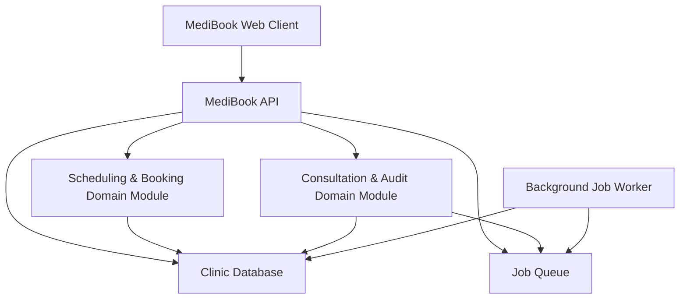
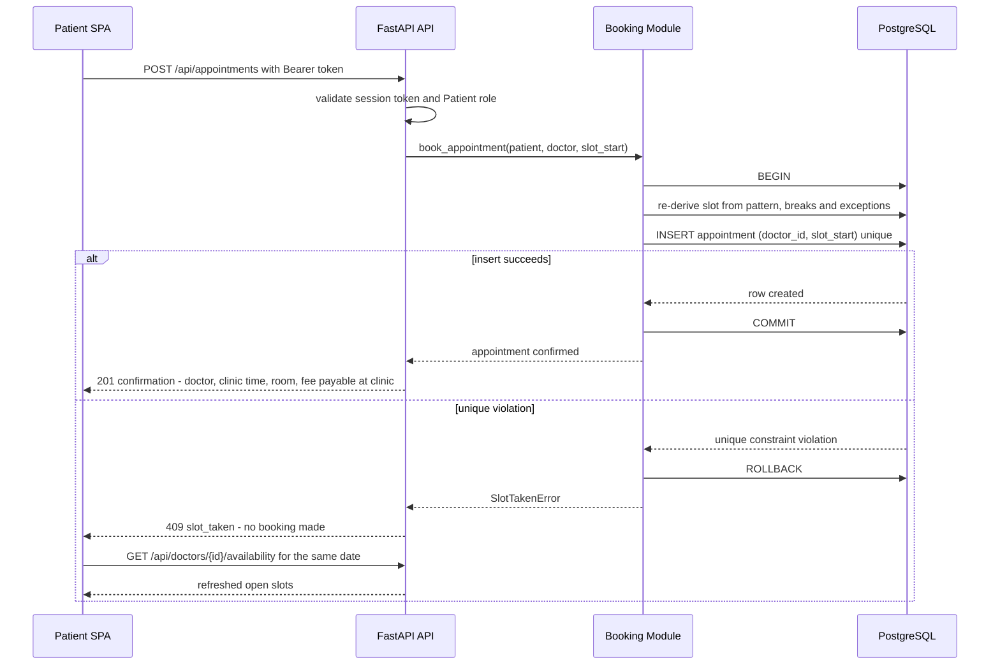
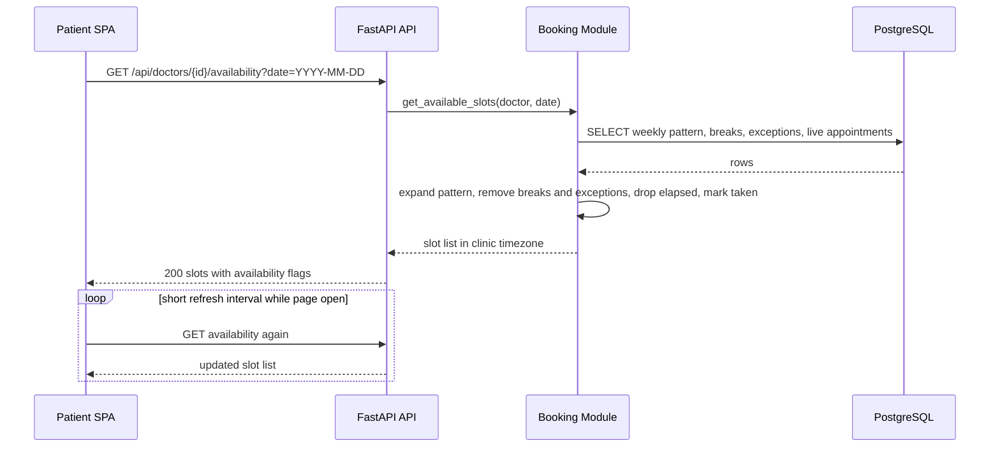
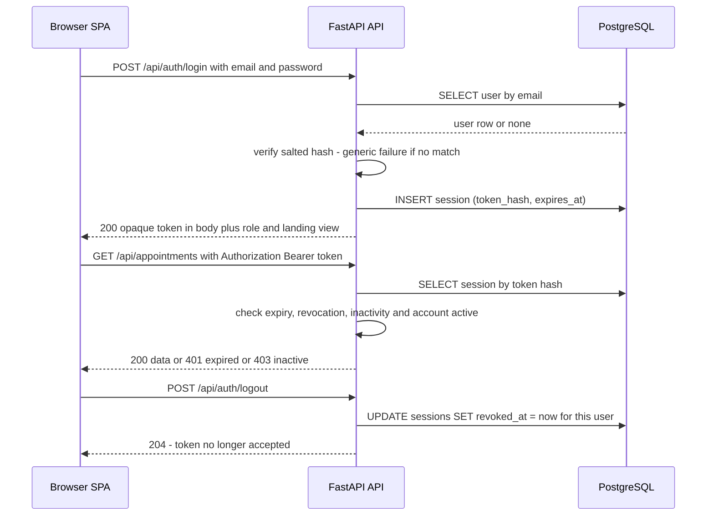
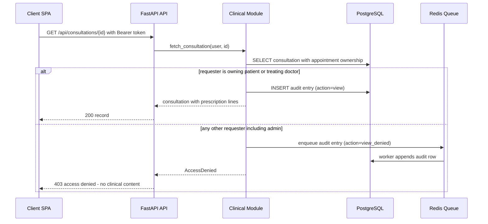
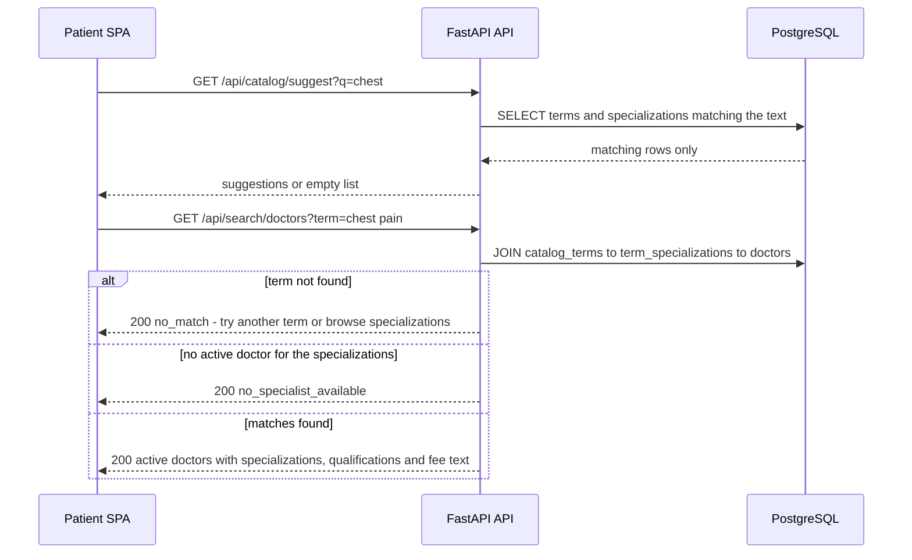
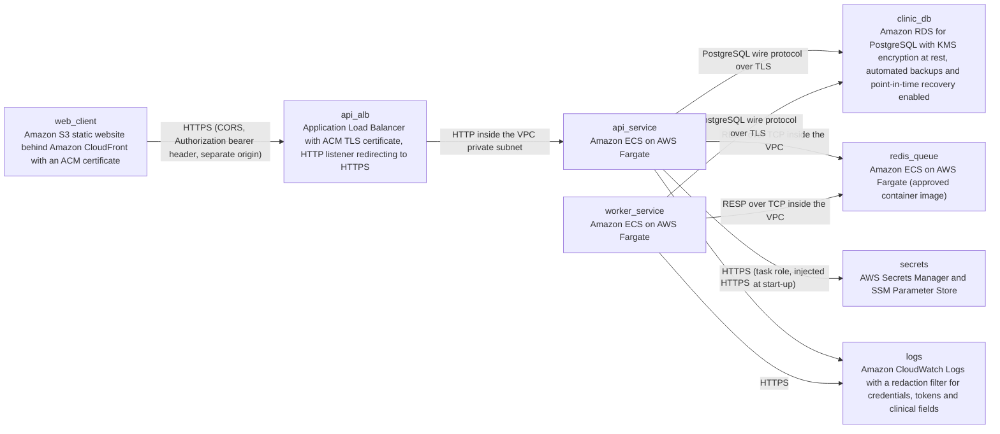

# Architecture

> Maintained by QuorQ AI SDLC. Text between `sdlc:auto` markers is regenerated; anything outside them is yours and is kept.

<!-- sdlc:auto:start narrative -->
## Overview

### ARCH-001 · approved · source: architecture:summary

MediBook is a single responsive React 19 SPA calling a FastAPI 0.115 JSON API over HTTPS, backed by PostgreSQL 16 on Amazon RDS with a Redis 7 container as a background job queue. SPA and API run on two different origins, so authentication uses server-side sessions with an opaque bearer token. The design rests on three guarantees: database-enforced no-double-booking, read-time slot derivation, and per-request role-plus-ownership checks on clinical records with full audit.

Approved architecture, version 1.

Shape:
- One responsive React 19 web client for all three roles (patient, doctor, administrator).
- FastAPI 0.115 JSON API over HTTPS; two origins (SPA and API served separately).
- PostgreSQL 16 on Amazon RDS as system of record; Redis 7 container as background job queue.

Authentication:
- Server-side sessions; login response body returns an opaque bearer token.
- Frontend stores the token and sends `Authorization: Bearer` on every call.
- Revoked on sign-out, inactivity, account deactivation, or an administrator-issued replacement password.

Booking guarantee:
- Unique constraint on (doctor_id, slot_start) over live statuses.
- Booking endpoint inserts inside one transaction; the loser of a race gets a clear 'slot just taken' response with a refreshed slot list and no partial row.

Availability:
- Bookable slots derived on read from each doctor's weekly pattern, breaks and one-off exceptions, in the single configured clinic timezone.
- Booked and already-past slots removed.
- Booking page re-fetches on open and on a short interval; no push layer.

Clinical data:
- Notes, diagnosis, advice and structured prescription lines reachable only by the owning patient and the treating doctor, enforced per-request by role plus ownership.
- Administrators see scheduling data only.
- Every view, create, edit and refused attempt on a consultation record writes an append-only audit entry carrying identifiers and actions but no clinical text.

Baseline health-data safeguards (configuration-led):
- TLS termination at the AWS load balancer.
- RDS encryption at rest with automated backups and point-in-time recovery.
- Salted one-way password hashes.

Explicitly not designed anywhere: payments, email, file uploads, telemedicine, AI matching.

**Related:** ARCH-C-01, ARCH-C-02, ARCH-C-03, ARCH-C-04, ARCH-C-05, ARCH-C-06, ARCH-C-07

### ARCH-C-01 · approved · source: architecture:component:web_spa

MediBook Web Client, a React 19 responsive single-page application serving patients, doctors and administrators from one codebase. It holds the opaque session token and attaches it as an Authorization bearer header on every API call. All dates and times render in the labelled clinic timezone.

Technology: React 19.

Responsibilities:
- Registration and sign-in.
- Disease/symptom search.
- Slot browsing with short-interval refresh.
- Booking, reschedule and cancellation.
- Doctor schedule management and appointment status updates.
- Consultation entry and printable patient history.
- Admin console.

Cross-cutting behaviour:
- Stores the opaque session token and sends it as `Authorization: Bearer` on every API call.
- Renders all dates and times in the labelled clinic timezone, never the device timezone.

**Related:** ARCH-001, ARCH-C-02, ARCH-TD-01, ARCH-DEP-01

### ARCH-C-02 · approved · source: architecture:component:api_service

MediBook API (FastAPI 0.115) is the HTTP surface and the single enforcement point for authentication, session validation, role checks and record-ownership checks on every request. It hosts the account, profile, specialization, doctor-profile, catalogue-search and clinic-settings endpoints and delegates to the booking and clinical domain modules.

Technology: FastAPI 0.115.

Owns directly:
- Account endpoints (register, login, logout, me).
- Patient profile endpoints.
- Specialization endpoints.
- Doctor-profile endpoints.
- Catalogue-search endpoints.
- Clinic-settings endpoints.

Delegates to:
- booking_core (scheduling, booking, reschedule, cancellation).
- clinical_records (consultations, prescriptions, audit).

Enforcement and disclosure rules:
- Single enforcement point for authentication, session validation, role checks and record-ownership checks on every request.
- Returns access-denied with no payload on role or ownership failures.
- Never emits passwords, tokens or clinical text into error bodies or logs.

**Related:** ARCH-001, ARCH-C-03, ARCH-C-04, ARCH-SEC-01, ARCH-TD-02

### ARCH-C-03 · approved · source: architecture:component:booking_core

Scheduling & Booking Domain Module, a Python domain module inside FastAPI 0.115 over PostgreSQL 16. It derives bookable slots on read from the doctor's weekly pattern, breaks and exceptions, and executes booking, reschedule and cancellation in a single transaction guarded by the unique (doctor_id, slot_start) constraint.

Technology: FastAPI 0.115 Python domain module over PostgreSQL 16.

Slot generation (on read, clinic timezone):
- Expands each doctor's weekly pattern, breaks and one-off exceptions.
- Excludes break periods, out-of-hours times, exception windows, already-booked slots and today's elapsed start times.

Transactional writes:
- Booking, reschedule and cancellation each execute in a single database transaction.
- Guarded by the unique (doctor_id, slot_start) constraint; a constraint violation is translated into the 'slot just taken' outcome.
- Enforces the administrator-configured booking cutoff.

**Related:** ARCH-001, ARCH-C-02, ARCH-CP-01, ARCH-CP-02, ARCH-DM-03

### ARCH-C-04 · approved · source: architecture:component:clinical_records

Consultation & Audit Domain Module, a Python domain module inside FastAPI 0.115 over PostgreSQL 16. It creates, updates and serves consultation notes, diagnosis, advice and structured prescription lines strictly to the owning patient and the treating doctor, refusing every other requester, and emits an append-only audit entry for each successful and refused access.

Technology: FastAPI 0.115 Python domain module over PostgreSQL 16.

Access rule:
- Serves consultation content only to the owning patient and the treating doctor.
- Refuses every other requester (including administrators and non-treating doctors).

Audit rule:
- Append-only audit entry written for each successful view, create and update, and for each refused attempt.
- Audit entry carries actor, record and patient identifiers, action and timestamp.
- Audit entry carries no clinical content.

**Related:** ARCH-001, ARCH-C-02, ARCH-CP-04, ARCH-DM-04, ARCH-SEC-01

### ARCH-C-05 · approved · source: architecture:component:background_worker

Background Job Worker, a Python arq worker running on the same FastAPI 0.115 codebase. It drains queued jobs from Redis for durable audit appends under load, batch cancellation fan-out when a doctor confirms leave over existing bookings, and scheduled housekeeping. It sits on no user-facing request path.

Technology: Python arq worker on the FastAPI 0.115 codebase.

Job types consumed from Redis:
- Durable append of audit entries buffered under load.
- Batch cancellation fan-out when a doctor confirms leave over existing bookings.
- Scheduled housekeeping, such as expiring stale sessions.

Constraint: carries no user-facing request path.

**Related:** ARCH-001, ARCH-C-07, ARCH-DEP-04

### ARCH-C-06 · approved · source: architecture:component:postgres_db

Clinic Database on PostgreSQL 16 is the system of record for users, sessions, profiles, specializations, the disease/symptom catalogue and mappings, availability, appointments, consultations, the append-only audit log and clinic settings. It owns the uniqueness constraint that makes double booking impossible and provides encryption at rest, automated backups and point-in-time recovery.

Technology: PostgreSQL 16.

System of record for:
- Users and sessions.
- Patient and doctor profiles.
- Specializations.
- Disease/symptom catalogue and its specialization mappings.
- Weekly availability with breaks and exceptions.
- Appointments and status history.
- Consultations and prescription lines.
- Append-only audit log.
- Clinic settings.

Guarantees owned at the database layer:
- Uniqueness constraint that makes double booking impossible.
- Encryption at rest, automated backups and point-in-time recovery.

**Related:** ARCH-001, ARCH-DM-01, ARCH-DM-02, ARCH-DM-03, ARCH-DM-04, ARCH-DM-05, ARCH-TD-03, ARCH-DEP-06

### ARCH-C-07 · approved · source: architecture:component:job_queue

Job Queue running Redis 7 (redis:7-alpine container). It is the queue and scheduler for deferred and retried background work, enqueued by the API and drained by the background worker.

Technology: Redis 7 (redis:7-alpine container).

Role:
- Redis-backed queue and scheduler for deferred and retried background work.
- Producers: the API service.
- Consumer: the background worker (arq).

**Related:** ARCH-001, ARCH-C-05, ARCH-DEP-05

### ARCH-CP-01 · approved · source: architecture:critical_path:booking

Critical path: book a slot with an unbreakable one-patient-per-slot guarantee. The API validates session and Patient role, re-derives the slot, checks for a duplicate live appointment, then inserts inside one transaction where PostgreSQL itself refuses the second insert. The race loser receives HTTP 409 slot_taken with no partial row; the winner receives a confirmation payload with no payment or video option.

Sequence:
1. Patient confirms an open slot.
2. API validates the session and the Patient role.
3. API re-derives the slot from the doctor's pattern and exceptions to confirm it is genuinely bookable and not in the past.
4. API checks for an existing live appointment the same patient already holds with that doctor at that time.
5. API opens one transaction and inserts the appointment.

Race handling:
- A unique constraint on (doctor_id, slot_start) restricted to live statuses lets PostgreSQL refuse the second insert.
- A unique-violation rolls the transaction back and leaves no partial row.
- Response: HTTP 409 with code `slot_taken`; the client renders 'that slot was just taken' alongside a freshly fetched slot list.

Winner's confirmation payload:
- Doctor, clinic-timezone date and time, clinic room, and the fee as text payable at the clinic.
- No payment option and no video option anywhere in it.

**Related:** ARCH-C-03, ARCH-C-06, ARCH-TD-03, ARCH-API-09

### ARCH-CP-02 · approved · source: architecture:critical_path:availability

Critical path: generate and keep slot availability fresh. The booking page fetches slots from the server on open and re-fetches on a short interval and on any doctor/date change, clearing the previous list first. The server expands the weekly pattern for that weekday, subtracts breaks, out-of-window times and unavailable exceptions, adds extra one-off windows, drops elapsed slots and marks booked slots unavailable.

Client behaviour:
- Fetches slots for the selected date straight from the server on page open.
- Re-fetches on a short interval while the page stays open, and whenever the doctor or date changes, clearing the previous list first.
- A failed fetch returns an error the client renders as an explicit unavailable-data state with nothing bookable.

Server derivation, in order:
1. Expand the doctor's weekly pattern for that weekday into fixed-length slots.
2. Subtract break periods and anything beyond the working window.
3. Subtract unavailable exceptions.
4. Add extra one-off windows at the doctor's slot length.
5. Drop today's slots whose start has already passed in clinic time.
6. Mark as unavailable any slot already held by a live appointment.

No push layer is used; freshness comes from interval polling.

**Related:** ARCH-C-01, ARCH-C-03, ARCH-API-08

### ARCH-CP-03 · approved · source: architecture:critical_path:session_lifecycle

Critical path: sign in, bearer session lifecycle and revocation. Login verifies the email and salted one-way password hash and returns one generic failure for unknown email or wrong password with no session created. On success a session row stores a hash of a freshly generated opaque token and the plaintext token is returned in the response body; every request re-validates and slides last_seen, and several events revoke all sessions for a user.

Login:
- Verifies email and the salted one-way password hash.
- Single generic failure message for unknown email or wrong password; no session created on failure.
- On success: stores a session row holding a hash of a freshly generated opaque token, its expiry and last-seen time; returns the plaintext token in the response body.
- The SPA keeps the token and sends `Authorization: Bearer` on every subsequent call.

Per-request validation:
- Look the session up.
- Reject if expired, revoked, past the inactivity window, or if the owning account is inactive.
- Otherwise slide `last_seen`.

Revocation events (revoke every session row for that user):
- Sign-out.
- Administrator deactivation of the account.
- Administrator-issued replacement password.

Effect: previously visited protected pages cannot be re-served after revocation.

**Related:** ARCH-C-02, ARCH-DM-01, ARCH-API-01, ARCH-SEC-01

### ARCH-CP-04 · approved · source: architecture:critical_path:consultation_ownership_audit

Critical path: record and read a consultation under ownership checks with audit. The treating doctor saves notes, a required diagnosis, advice and ordered prescription lines against their own completed appointment. Non-treating doctors, other patients and administrators are refused with access denied and no payload, and the refusal itself is audited. The audit log has no edit or delete path.

Write path:
- Treating doctor saves against their own completed appointment: notes, a required diagnosis, advice, and zero or more ordered prescription lines.
- Each prescription line carries medicine, dosage and duration as separate columns.

Read/refusal path:
- Any non-treating doctor, any other patient and any administrator requesting the record by identifier is refused with access denied and no payload.
- The refusal is itself audited.

Audit:
- Every successful view, create and update writes an append-only audit entry recording actor, consultation and patient identifiers, action and timestamp.
- No clinical text is written to the audit log.
- Administrators may read the audit log; the application exposes no edit or delete path for it.

**Related:** ARCH-C-04, ARCH-DM-04, ARCH-API-10, ARCH-API-11, ARCH-SEC-01

### ARCH-CP-05 · approved · source: architecture:critical_path:catalogue_search

Critical path: deterministic disease and symptom search to doctor results. From two characters onward the API returns suggestions by plain case-insensitive prefix and substring matching over stored terms and specialization names, with no AI, LLM or ML in the path. A submitted term resolves through the term-to-specialization join to active doctors; unmatched terms and specializations with no active doctors return explicit outcomes.

Suggestion step:
- Triggered when the patient types at least two characters.
- Plain case-insensitive prefix and substring matching on stored catalogue terms and specialization names.
- No AI, language model or machine learning anywhere in the path.

Resolution step:
- Submitting a term resolves it through the term-to-specialization join to one or more specializations.
- Lists every active doctor holding those specializations, with specializations, qualifications and the fee as informational text.

Explicit negative outcomes:
- Unmatched term: explicit no-match response; never an invented suggestion.
- Matched specialization with no active doctors: explicit no-specialist response.

**Related:** ARCH-C-02, ARCH-DM-02, ARCH-API-06, ARCH-TD-03

### ARCH-DM-01 · approved · source: architecture:entities:identity

Data model area: identity, sessions and patient profile. Covers the users, sessions and patient_profiles tables that back registration, role-based access, bearer-session validation and revocation, and patient self-service profile data.

Entities and fields as specified:
- users: id, full_name, email, password_hash, role, is_active, password_changed_at, created_at, updated_at
- sessions: id, user_id, token_hash, created_at, last_seen_at, expires_at, revoked_at, revoked_reason
- patient_profiles: user_id, phone, date_of_birth, gender, updated_at

Notes from the architecture input:
- sessions stores a hash of the opaque token, not the token itself.
- revoked_at / revoked_reason support sign-out, deactivation and administrator password replacement.
- users.is_active gates session validity on every request.

**Related:** ARCH-C-06, ARCH-CP-03

### ARCH-DM-02 · approved · source: architecture:entities:catalogue_directory

Data model area: specializations, doctor directory and the disease/symptom catalogue. Covers specializations, doctors, doctor_specializations, catalog_terms and term_specializations, which together power the deterministic term-to-specialization-to-doctor search.

Entities and fields as specified:
- specializations: id, name, description, is_active, created_at
- doctors: id, user_id, display_name, qualifications, biography, room_location, consultation_fee, is_active, updated_at
- doctor_specializations: doctor_id, specialization_id
- catalog_terms: id, term, entry_type, seed_key, admin_modified, deleted_at, created_at
- term_specializations: term_id, specialization_id

Notes from the architecture input:
- catalog_terms.deleted_at supports soft deletion so a term stops resolving while booked appointments stay untouched and re-seeding will not recreate it.
- seed_key and admin_modified distinguish seeded entries from administrator-created or administrator-edited ones.
- doctors.consultation_fee is surfaced as informational text payable at the clinic (no payment feature).

**Related:** ARCH-C-06, ARCH-CP-05, ARCH-API-04, ARCH-API-05, ARCH-API-07

### ARCH-DM-03 · approved · source: architecture:entities:scheduling

Data model area: availability and appointments. Covers doctor_weekly_availability, availability_breaks, availability_exceptions, appointments and appointment_status_history — the tables from which slots are derived and against which the no-double-booking constraint is enforced.

Entities and fields as specified:
- doctor_weekly_availability: id, doctor_id, day_of_week, start_time, end_time, slot_minutes, updated_at
- availability_breaks: id, weekly_availability_id, start_time, end_time
- availability_exceptions: id, doctor_id, exception_date, exception_type, start_time, end_time, reason, created_at
- appointments: id, doctor_id, patient_user_id, slot_start, slot_end, status, reason_for_visit, cancelled_by_user_id, cancelled_by_role, cancellation_reason, cancelled_at, rescheduled_from_slot_start, created_at, updated_at
- appointment_status_history: id, appointment_id, from_status, to_status, changed_by_user_id, reason, changed_at

Constraint:
- Partial unique index on (doctor_id, slot_start) where status is not cancelled; enforced by the engine inside the booking transaction rather than by application code.

Notes:
- availability_exceptions covers both unavailable (leave) and extra one-off hours via exception_type.
- appointment_status_history records who changed a status, from what to what, why and when.

**Related:** ARCH-C-03, ARCH-C-06, ARCH-CP-01, ARCH-CP-02

### ARCH-DM-04 · approved · source: architecture:entities:clinical_audit

Data model area: clinical records and audit. Covers consultations, prescription_lines and the insert-only audit_log, which holds actor, action, resource and patient identifiers and outcome but never clinical content.

Entities and fields as specified:
- consultations: id, appointment_id, doctor_id, patient_user_id, diagnosis, notes, advice, created_by_user_id, created_at, updated_at
- prescription_lines: id, consultation_id, line_order, medicine, dosage, duration
- audit_log: id, actor_user_id, actor_role, action, resource_type, resource_id, subject_patient_user_id, outcome, occurred_at

Notes from the architecture input:
- prescription_lines keeps medicine, dosage and duration as separate columns with an explicit line_order.
- audit_log is append-only / insert-only; outcome distinguishes successful access from refused attempts.
- No clinical text is ever stored in audit_log.

**Related:** ARCH-C-04, ARCH-C-06, ARCH-CP-04, ARCH-SEC-01

### ARCH-DM-05 · approved · source: architecture:entities:clinic_settings

Data model area: clinic settings. A single settings record holds the clinic name, the one configured timezone and its confirmation flag, the booking cutoff in hours and the session idle window, which drive time rendering, booking refusal and session expiry.

Entity and fields as specified:
- clinic_settings: id, clinic_name, timezone, timezone_confirmed, booking_cutoff_hours, session_idle_minutes, updated_by_user_id, updated_at

Use across the system:
- timezone and timezone_confirmed: every client labels and formats times in this single clinic timezone, never the device timezone.
- booking_cutoff_hours: enforced by the booking domain module on reschedule and cancellation.
- session_idle_minutes: the inactivity window checked on every request.
- updated_by_user_id / updated_at: record which administrator last changed the settings.

**Related:** ARCH-C-06, ARCH-API-12, ARCH-CP-02, ARCH-CP-03

### ARCH-API-01 · approved · source: architecture:endpoints:auth

API surface: authentication and session. Covers patient self-registration, login for any role, logout and the client-bootstrap identity call. Failures are generic on login and per-field on registration.

- POST /api/auth/register — Patient self-registration. Rejects a duplicate email and invalid fields per-field, with nothing partially written.
- POST /api/auth/login — Authenticate any role and open a server-side session. One generic failure message for unknown email or wrong password.
- POST /api/auth/logout — Revoke the bearer session immediately so protected pages cannot be re-served.
- GET /api/auth/me — Current user, role and session validity for client bootstrap.

**Related:** ARCH-CP-03, ARCH-DM-01

### ARCH-API-02 · approved · source: architecture:endpoints:patient_self_service

API surface: patient self-service profile. The signed-in patient can read and update their own profile and change their own password with the current password supplied.

- GET /api/patients/me — The signed-in patient's own profile.
- PATCH /api/patients/me — Update own name, phone, date of birth and gender.
- POST /api/patients/me/password — Change own password with the current password supplied.

**Related:** ARCH-DM-01

### ARCH-API-03 · approved · source: architecture:endpoints:admin_users

API surface: administrator account management. Administrators create doctor and administrator accounts with a one-time initial password, list accounts, activate/deactivate them and issue replacement passwords. Deactivation and password replacement both revoke every session the account holds.

- POST /api/admin/users — Create a doctor or administrator account with an initial password returned once for hand-off.
- GET /api/admin/users — List staff and patient accounts with role and active status. No clinical content.
- PATCH /api/admin/users/{user_id} — Activate or deactivate an account. Deactivation revokes every session that account holds.
- POST /api/admin/users/{user_id}/password — Issue a replacement password for a doctor or administrator. The old password stops working and all their sessions are revoked.

**Related:** ARCH-CP-03, ARCH-DM-01

### ARCH-API-04 · approved · source: architecture:endpoints:specializations

API surface: specializations. Patients receive active specializations only; administrators can create, edit and activate/deactivate them. Deletion is refused while doctors or catalogue mappings still reference the specialization.

- GET /api/specializations — List specializations. Patients receive active ones only.
- POST /api/admin/specializations — Create a specialization, rejecting a duplicate name.
- PATCH /api/admin/specializations/{id} — Rename, re-describe, activate or deactivate a specialization.
- DELETE /api/admin/specializations/{id} — Refused while doctors or catalogue mappings reference it; returns the reference counts and offers deactivation instead.

**Related:** ARCH-DM-02

### ARCH-API-05 · approved · source: architecture:endpoints:doctor_directory

API surface: doctor directory and doctor profile maintenance. Patients see active doctors only and get a `doctor_unavailable` outcome if a doctor was deactivated after results loaded. Administrators maintain doctor profiles, which require at least one specialization.

- GET /api/doctors — Doctor directory with specialization and name filters. Active doctors only for patients.
- GET /api/doctors/{doctor_id} — Doctor profile for the booking page. Returns `doctor_unavailable` if the doctor was deactivated since the results were loaded.
- PUT /api/admin/doctors/{doctor_id} — Maintain a doctor profile. Requires at least one specialization and reports the count of affected future appointments when deactivating.

**Related:** ARCH-DM-02, ARCH-CP-02

### ARCH-API-06 · approved · source: architecture:endpoints:catalogue_search

API surface: deterministic catalogue search. Suggestions require at least two characters and use plain text matching over stored disease, symptom and specialization names. Term resolution maps to specializations and lists matching active doctors, with explicit no-match and no-specialist outcomes.

- GET /api/catalog/suggest — Deterministic text-match suggestions over stored disease, symptom and specialization names. Minimum two characters. No AI or ML.
- GET /api/search/doctors — Resolve a catalogue term through the mapping to specializations and list matching active doctors, with explicit no-match and no-specialist outcomes.

**Related:** ARCH-CP-05, ARCH-DM-02

### ARCH-API-07 · approved · source: architecture:endpoints:admin_catalog_terms

API surface: administrator maintenance of the disease/symptom catalogue. Administrators list, add, edit and soft-delete catalogue terms and their specialization mappings; at least one specialization is always required.

- GET /api/admin/catalog-terms — List catalogue entries with term, entry type and mapped specializations, seeded and administrator-created alike.
- POST /api/admin/catalog-terms — Add a catalogue term mapped to one or more active specializations.
- PUT /api/admin/catalog-terms/{id} — Edit a term or its mappings. At least one specialization is required.
- DELETE /api/admin/catalog-terms/{id} — Soft-delete a term so it stops resolving, while booked appointments stay untouched and re-seeding will not recreate it.

**Related:** ARCH-DM-02, ARCH-CP-05

### ARCH-API-08 · approved · source: architecture:endpoints:availability

API surface: availability. One public-facing endpoint returns freshly derived bookable slots for a date; the signed-in doctor manages their weekly pattern with breaks and their one-off exceptions. Pattern changes warn about bookings that fall outside the new pattern, and leave over existing bookings requires explicit confirmation before cancellation.

- GET /api/doctors/{doctor_id}/availability — Freshly derived bookable slots for one date in the clinic timezone, excluding breaks, exceptions, elapsed and taken slots.
- GET /api/doctors/me/weekly-availability — The signed-in doctor's weekly pattern with breaks, as a week view.
- PUT /api/doctors/me/weekly-availability — Replace the weekly pattern. Validates times, slot length and non-overlapping in-hours breaks per day; warns with the list of booked appointments that fall outside the new pattern without deleting them.
- GET /api/doctors/me/exceptions — List the doctor's one-off unavailable and extra-hours exceptions.
- POST /api/doctors/me/exceptions — Record leave or extra one-off hours for today or a future date. When bookings fall inside leave, returns them for explicit confirmation, then cancels each with the reason recorded.
- DELETE /api/doctors/me/exceptions/{id} — Remove an exception so the normal pattern applies again.

**Related:** ARCH-C-03, ARCH-CP-02, ARCH-DM-03

### ARCH-API-09 · approved · source: architecture:endpoints:appointments

API surface: appointment lifecycle. Booking is a single guarded transaction returning slot_taken to the race loser. Reads are scoped to the caller's role and ownership, with administrators limited to scheduling fields. Reschedule, patient cancellation and doctor status changes are refused inside the cutoff or at a final status.

- POST /api/appointments — Book one slot inside a transaction guarded by the unique (doctor_id, slot_start) constraint. The loser of a race receives `slot_taken` and no row is written.
- GET /api/appointments — Appointments scoped to the caller: a patient sees only their own, a doctor only those they treat. Supports upcoming/past split, date range and status filters.
- GET /api/appointments/{id} — One appointment, returned only to its patient or its treating doctor. Administrators receive scheduling fields only and never clinical content.
- POST /api/appointments/{id}/reschedule — Move the appointment to another open slot in one transaction, freeing the old slot immediately. Refused inside the cutoff or at a final status.
- POST /api/appointments/{id}/cancel — Patient cancellation outside the cutoff. Records canceller and time and frees the slot at once.
- PATCH /api/appointments/{id}/status — Treating doctor moves the appointment to confirmed, completed, no_show or cancelled with a reason. Records who and when; refuses final-status changes and any doctor who is not the treating doctor.

**Related:** ARCH-CP-01, ARCH-DM-03, ARCH-C-03

### ARCH-API-10 · approved · source: architecture:endpoints:consultations

API surface: consultations and prescriptions. The treating doctor records and edits notes, a required diagnosis, advice and ordered prescription lines; reads are served only to the owning patient or the treating doctor. Every success and every refusal writes an audit entry.

- POST /api/appointments/{id}/consultation — Treating doctor records notes, a required diagnosis, advice and zero or more ordered prescription lines. Writes a create audit entry.
- PUT /api/consultations/{id} — Treating doctor edits and re-saves a consultation and its prescription lines. Writes an update audit entry.
- GET /api/consultations/{id} — Returns the record only to the owning patient or the treating doctor, including the print payload fields. Every success writes a view audit entry; every refusal writes a denied entry.
- GET /api/consultations — The signed-in patient's own consultation history, most recent first, with date, doctor, specialization and diagnosis.

**Related:** ARCH-CP-04, ARCH-C-04, ARCH-DM-04

### ARCH-API-11 · approved · source: architecture:endpoints:audit_log

API surface: audit log. Administrators have a single read-only endpoint over the append-only log of consultation access. It shows actor, action, record and patient identifiers and timestamp, never clinical content, and no write, edit or delete endpoint exists.

- GET /api/admin/audit-log — Read-only, append-only audit log of consultation access. Shows actor, action, record and patient identifiers and timestamp; never clinical content.

Design constraint: no write, edit or delete endpoint exists for the audit log anywhere in the API.

**Related:** ARCH-CP-04, ARCH-DM-04, ARCH-SEC-01

### ARCH-API-12 · approved · source: architecture:endpoints:settings

API surface: clinic settings. All clients read the clinic timezone, its confirmation flag and the booking cutoff in order to label and format times. Administrators set the single clinic timezone and the cutoff, effective immediately, with invalid cutoffs rejected.

- GET /api/settings — Clinic timezone, its confirmation flag and the booking cutoff, needed by every client to label and format times.
- PUT /api/admin/settings — Set the single clinic timezone and the booking cutoff in hours, effective immediately. A negative or non-numeric cutoff is rejected and the previous value stays in force.

**Related:** ARCH-DM-05, ARCH-CP-02

### ARCH-DEP-01 · approved · source: architecture:deployment:web_client

Deployment node web_client: the React 19 production build is published as static assets to an Amazon S3 static website fronted by Amazon CloudFront with an ACM certificate.

- Platform: Amazon S3 static website behind Amazon CloudFront.
- Artifact: React 19 production build (static assets).
- TLS: ACM certificate on CloudFront.
- This origin is separate from the API origin, which is why session state is carried by a bearer token rather than a cookie.

**Related:** ARCH-C-01, ARCH-TD-04

### ARCH-DEP-02 · approved · source: architecture:deployment:api_alb

Deployment node api_alb: an AWS-managed Application Load Balancer with an ACM TLS certificate terminates TLS in front of the API, with the HTTP listener redirecting to HTTPS.

- Platform: Application Load Balancer (AWS managed).
- TLS termination with an ACM certificate.
- HTTP listener redirects to HTTPS.
- This is the stated location of TLS termination for the baseline health-data safeguards.

**Related:** ARCH-DEP-03, ARCH-SEC-01

### ARCH-DEP-03 · approved · source: architecture:deployment:api_service

Deployment node api_service: the FastAPI 0.115 application on Python 3.12 runs as a uvicorn container on Amazon ECS with AWS Fargate.

- Platform: Amazon ECS on AWS Fargate.
- Runtime: FastAPI 0.115 on Python 3.12, uvicorn container.
- Hosts the API service together with the booking and clinical domain modules.

**Related:** ARCH-C-02, ARCH-C-03, ARCH-C-04, ARCH-TD-02

### ARCH-DEP-04 · approved · source: architecture:deployment:worker_service

Deployment node worker_service: a Python 3.12 arq worker runs on Amazon ECS with AWS Fargate, using the same FastAPI 0.115 container image as the API.

- Platform: Amazon ECS on AWS Fargate.
- Runtime: Python 3.12 arq worker on the same FastAPI 0.115 image as api_service.
- Drains the Redis job queue; no user-facing request path.

**Related:** ARCH-C-05, ARCH-DEP-05

### ARCH-DEP-05 · approved · source: architecture:deployment:redis_queue

Deployment node redis_queue: the redis:7-alpine approved container image runs on Amazon ECS with AWS Fargate as the job queue and scheduler.

- Platform: Amazon ECS on AWS Fargate (approved container image).
- Image: redis:7-alpine.
- Connection string (REDIS_URL) is held in AWS Secrets Manager.

**Related:** ARCH-C-07, ARCH-DEP-04

### ARCH-DEP-06 · approved · source: architecture:deployment:clinic_db

Deployment node clinic_db: PostgreSQL 16 on Amazon RDS with KMS encryption at rest, automated backups and point-in-time recovery enabled.

- Platform: Amazon RDS for PostgreSQL, PostgreSQL 16.
- KMS encryption at rest.
- Automated backups enabled.
- Point-in-time recovery enabled.
- These three settings are the stated data-at-rest safeguards for health data.
- Connection string (DATABASE_URL) is held in AWS Secrets Manager.

**Related:** ARCH-C-06, ARCH-SEC-01, ARCH-TD-03

### ARCH-DEP-07 · approved · source: architecture:deployment:secrets

Deployment node secrets: AWS Secrets Manager and SSM Parameter Store hold the service configuration and credentials, including DATABASE_URL and REDIS_URL.

- Platform: AWS Secrets Manager and SSM Parameter Store (AWS managed).
- Stated contents: DATABASE_URL and REDIS_URL.
- Consumed by the API service and the worker service at runtime.

**Related:** ARCH-DEP-03, ARCH-DEP-05, ARCH-DEP-06

### ARCH-DEP-08 · approved · source: architecture:deployment:logs

Deployment node logs: Amazon CloudWatch Logs with a redaction filter for credentials, tokens and clinical fields, complementing the API rule that passwords, tokens and clinical text never reach error bodies or logs.

- Platform: Amazon CloudWatch Logs (AWS managed).
- Redaction filter applied for credentials, tokens and clinical fields.
- Paired application-level rule (from api_service): never emit passwords, tokens or clinical text into error bodies or logs.

**Related:** ARCH-C-02, ARCH-SEC-01

### ARCH-TD-01 · approved · source: architecture:technology:frontend

Technology decision — Frontend: React 19, chosen over Vue 3, Angular 18 and Svelte. One responsive codebase carries all three roles behind a single bearer-token auth guard, with a component tree per role.

Chosen: React 19.
Alternatives considered: Vue 3, Angular 18, Svelte.

Stated rationale:
- One responsive codebase serves the patient booking on a phone, the doctor writing a consultation on a tablet, and the administrator working a filterable list.
- A component tree per role sits behind one bearer-token auth guard.
- The slot page uses interval polling against the availability endpoint for freshness.
- The printable consultation view is a print-stylesheet route with no navigation chrome.

**Related:** ARCH-C-01, ARCH-CP-02

### ARCH-TD-02 · approved · source: architecture:technology:backend

Technology decision — Backend: FastAPI 0.115, chosen over Django REST Framework, Express and Spring Boot. It gives one place for the three rules the product rests on: the booking transaction, the role-plus-ownership dependency, and the audit write on every consultation view.

Chosen: FastAPI 0.115.
Alternatives considered: Django REST Framework, Express, Spring Boot.

Stated rationale:
- The booking transaction lets the database refuse a second insert and returns `slot_taken` to the loser.
- A role-plus-ownership dependency keeps clinical notes away from administrators and other doctors.
- An audit write occurs on every consultation view.
- Pydantic request models produce the per-field inline validation errors the forms need.
- Slot generation from weekly patterns and exceptions is plain Python over the clinic timezone.

**Related:** ARCH-C-02, ARCH-CP-01, ARCH-CP-04

### ARCH-TD-03 · approved · source: architecture:technology:database

Technology decision — Database: PostgreSQL 16, chosen over MySQL 8, SQLite and MongoDB. The no-double-booking promise is implemented as a partial unique index on (doctor_id, slot_start) where status is not cancelled, enforced by the engine rather than application code.

Chosen: PostgreSQL 16.
Alternatives considered: MySQL 8, SQLite, MongoDB.

Stated rationale:
- Partial unique index on (doctor_id, slot_start) where status is not cancelled, enforced by the engine inside the booking transaction.
- Disease-to-specialization mapping handled as a join table.
- Append-only audit log as an insert-only table.
- Catalogue suggestions via case-insensitive text matching using citext and trigram indexes.
- timestamptz arithmetic in the clinic timezone.
- No separate search service needed: the catalogue is a few thousand rows matched by plain SQL.

**Related:** ARCH-C-06, ARCH-DM-03, ARCH-CP-01, ARCH-CP-05

### ARCH-TD-04 · approved · source: architecture:technology:cloud

Technology decision — Cloud: AWS, chosen over Azure, Google Cloud and DigitalOcean. The three safeguards the clinic committed to arrive as configuration: RDS encryption at rest with KMS, automated backups with point-in-time recovery, and TLS termination at the ALB with an ACM certificate.

Chosen: AWS.
Alternatives considered: Azure, Google Cloud, DigitalOcean.

Stated rationale:
- RDS encryption at rest with KMS.
- Automated backups with point-in-time recovery.
- TLS termination at the Application Load Balancer with an ACM certificate.
- ECS Fargate runs the API, the worker and the approved redis:7-alpine container without managing hosts.
- Secrets Manager holds DATABASE_URL and REDIS_URL.
- A single-region deployment keeps identifiable health data resident where the clinic's regulations allow.

**Related:** ARCH-DEP-01, ARCH-DEP-02, ARCH-DEP-03, ARCH-DEP-06, ARCH-SEC-01

### ARCH-SEC-01 · approved · source: architecture:summary

Cross-cutting: baseline health-data safeguards as designed. Access control is per-request role plus record ownership, clinical access is fully audited in an append-only log with no edit or delete path, transport is TLS-terminated at the load balancer, data at rest is KMS-encrypted with backups and point-in-time recovery, and passwords are salted one-way hashes. Listed here for human compliance confirmation only — not legal advice.

Access control:
- Single enforcement point in the API: authentication, session validation, role checks and record-ownership checks on every request.
- Clinical content reachable only by the owning patient and the treating doctor; administrators see scheduling data only.
- Access-denied responses carry no payload.

Audit controls:
- Append-only audit entry on every view, create, edit and refused attempt against a consultation record.
- Entries carry actor, record and patient identifiers, action, outcome and timestamp — never clinical text.
- Administrators can read the audit log; no write, edit or delete endpoint exists.

Authentication safeguards:
- Salted one-way password hashes.
- Opaque bearer tokens stored only as hashes in the sessions table.
- Revocation on sign-out, inactivity, account deactivation and administrator-issued replacement password.

Transport and storage:
- TLS termination at the AWS Application Load Balancer with an ACM certificate; HTTP redirects to HTTPS.
- RDS KMS encryption at rest, automated backups and point-in-time recovery.
- Single-region deployment for data residency.

Logging:
- CloudWatch Logs redaction filter for credentials, tokens and clinical fields; the API never emits passwords, tokens or clinical text into error bodies or logs.

Note: the architecture input describes these as 'baseline health-data safeguards' and names no specific regulation or domain skill. These rows are traceability pointers for a human reviewer to confirm against the clinic's applicable regulations; they are not legal advice and no certification is claimed.

**Related:** ARCH-CP-03, ARCH-CP-04, ARCH-DEP-02, ARCH-DEP-06, ARCH-DEP-08, ARCH-API-11

### ARCH-SCOPE-01 · approved · source: architecture:summary

Cross-cutting: capabilities explicitly excluded from the architecture. No payments, email, file uploads, telemedicine or AI matching are designed anywhere in the system.

Explicitly out of the architecture:
- Payments / payment gateway — the consultation fee appears only as informational text payable at the clinic, including in the booking confirmation payload.
- Email.
- File uploads.
- Telemedicine / video — no video option anywhere in the booking confirmation or elsewhere.
- AI, language models or machine learning — disease/symptom matching is plain deterministic case-insensitive prefix and substring SQL matching.

Also not used: any push layer for availability freshness (interval polling instead), and any separate search service (plain SQL over a few thousand catalogue rows).

**Related:** ARCH-001, ARCH-CP-01, ARCH-CP-05
<!-- sdlc:auto:end narrative -->

<!-- sdlc:auto:start building-blocks -->
## Building Block View

| ID | Name | Technology | Responsibility | Depends on |
|---|---|---|---|---|
| web_spa | MediBook Web Client | React 19 | Responsive single-page application for patients, doctors and administrators: registration and sign-in, disease/symptom search, slot browsing with short-interval refresh, booking, reschedule and cancellation, doctor schedule and status updates, consultation entry and printable patient history, and the admin console. Stores the opaque session token and sends it as an Authorization bearer header on every API call. Renders all dates and times in the labelled clinic timezone, never the device timezone. | api_service |
| api_service | MediBook API | FastAPI 0.115 | HTTP API and the single enforcement point for authentication, session validation, role checks and record-ownership checks on every request. Hosts the account, profile, specialization, doctor-profile, catalogue-search and clinic-settings endpoints, and delegates to the booking and clinical domain modules. Returns access-denied with no payload on role or ownership failures and never emits passwords, tokens or clinical text into error bodies or logs. | booking_core, clinical_records, postgres_db, job_queue |
| booking_core | Scheduling & Booking Domain Module | FastAPI 0.115 (Python domain module) over PostgreSQL 16 | Generates bookable slots on read from each doctor's weekly pattern, breaks and one-off exceptions in the clinic timezone, excluding break periods, out-of-hours times, exception windows, already-booked slots and today's elapsed start times. Executes booking, reschedule and cancellation in a single database transaction guarded by the unique (doctor_id, slot_start) constraint, translating a constraint violation into the 'slot just taken' outcome, and enforces the administrator-configured cutoff. | postgres_db |
| clinical_records | Consultation & Audit Domain Module | FastAPI 0.115 (Python domain module) over PostgreSQL 16 | Creates, updates and serves consultation notes, diagnosis, advice and structured prescription lines strictly to the owning patient and the treating doctor, and refuses every other requester. Emits an append-only audit entry for each successful view, create, update and refused attempt, carrying actor, record and patient identifiers, action and timestamp but no clinical content. | postgres_db, job_queue |
| background_worker | Background Job Worker | Python worker (arq) on FastAPI 0.115 codebase | Consumes queued jobs from Redis: durable append of audit entries buffered under load, batch cancellation fan-out when a doctor confirms leave over existing bookings, and scheduled housekeeping such as expiring stale sessions. Carries no user-facing request path. | job_queue, postgres_db |
| postgres_db | Clinic Database | PostgreSQL 16 | System of record for users, sessions, patient and doctor profiles, specializations, the disease/symptom catalogue and its mappings, weekly availability with breaks and exceptions, appointments, status history, consultations, prescription lines, the append-only audit log and clinic settings. Owns the uniqueness constraint that makes double booking impossible and provides encryption at rest, automated backups and point-in-time recovery. | — |
| job_queue | Job Queue | Redis 7 (redis:7-alpine container) | Redis-backed queue and scheduler for deferred and retried background work enqueued by the API and drained by the worker. | — |

<!-- sdlc:auto:end building-blocks -->

<!-- sdlc:auto:start runtime -->
## Runtime View

### Book a slot with an unbreakable one-patient-per-slot guarantee

The patient confirms an open slot. The API validates the session and the Patient role, re-derives the slot from the doctor's pattern and exceptions to confirm it is genuinely bookable and not in the past, checks for an existing live appointment the same patient holds with that doctor at that time, then opens one transaction and inserts the appointment. A unique constraint on (doctor_id, slot_start) restricted to live statuses lets PostgreSQL itself refuse the second insert. A unique-violation rolls the transaction back, leaves no partial row and returns HTTP 409 with code slot_taken, which the client renders as 'that slot was just taken' alongside a freshly fetched slot list. The winner receives the confirmation payload with doctor, clinic-timezone date and time, clinic room and the fee as text payable at the clinic, with no payment or video option anywhere in it.

- **Components:** web_spa, api_service, booking_core, postgres_db
- **Modules:** api/routers/appointments.py, domain/booking/service.py, domain/booking/slot_generator.py, domain/booking/errors.py, db/repositories/appointment_repo.py
- **Key functions:** book_appointment(session_user, doctor_id, slot_start, reason), assert_slot_is_bookable(doctor_id, slot_start, now_clinic_tz), insert_appointment_or_conflict(tx, doctor_id, patient_id, slot_start, slot_end, reason), reject_duplicate_for_patient(tx, patient_id, doctor_id, slot_start), map_unique_violation_to_slot_taken(exc)

### Generate and keep slot availability fresh

Opening a doctor's booking page fetches slots for the selected date straight from the server, and the client re-fetches on a short interval while the page stays open and whenever the doctor or date changes, clearing the previous list first. The server expands the doctor's weekly pattern for that weekday into fixed-length slots, subtracts break periods and anything beyond the working window, subtracts unavailable exceptions, adds extra one-off windows at the doctor's slot length, drops today's slots whose start has already passed in clinic time, and marks as unavailable any slot already held by a live appointment. A failed fetch returns an error the client renders as an explicit unavailable-data state with nothing bookable.

- **Components:** web_spa, api_service, booking_core, postgres_db
- **Modules:** api/routers/availability.py, domain/booking/slot_generator.py, domain/settings/clinic_settings.py, web/src/features/booking/useSlotPolling.ts
- **Key functions:** get_available_slots(doctor_id, date, clinic_tz), expand_weekly_pattern(pattern, breaks, slot_minutes, date), apply_exceptions(slots, exceptions, date), mark_taken(slots, live_appointments), drop_elapsed(slots, now_clinic_tz)

### Sign in, bearer session lifecycle and revocation

Login verifies the email and the salted one-way password hash and returns a single generic failure for unknown email or wrong password, with no session created. On success the server stores a session row holding a hash of a freshly generated opaque token, its expiry and last-seen time, and returns the plaintext token in the response body; the SPA keeps it and sends Authorization: Bearer on every subsequent call. Each request looks the session up, rejects it if expired, revoked, past the inactivity window, or if the owning account is inactive, then slides last_seen. Sign-out, administrator deactivation and an administrator-issued replacement password all revoke every session row for that user, so previously visited protected pages cannot be re-served.

- **Components:** web_spa, api_service, postgres_db
- **Modules:** api/routers/auth.py, api/deps/current_user.py, domain/auth/sessions.py, domain/auth/passwords.py, web/src/lib/apiClient.ts
- **Key functions:** login(email, password), issue_session_token(user_id, ttl_minutes), resolve_session(bearer_token, now), revoke_all_sessions(user_id, reason), require_role(roles), require_owner(resource)

### Record and read a consultation under ownership checks with audit

The treating doctor saves notes, a required diagnosis, advice and zero or more ordered prescription lines against their own completed appointment, each line carrying medicine, dosage and duration as separate columns. Any non-treating doctor, any other patient and any administrator requesting the record by identifier is refused with access denied and no payload, and the refusal itself is audited. Every successful view, create and update writes an append-only audit entry recording actor, consultation and patient identifiers, action and timestamp and no clinical text. Administrators may read the audit log but the application exposes no edit or delete path for it.

- **Components:** web_spa, api_service, clinical_records, postgres_db, job_queue, background_worker
- **Modules:** api/routers/consultations.py, domain/clinical/consultation_service.py, domain/clinical/prescription_lines.py, domain/audit/audit_writer.py, worker/tasks/audit_flush.py
- **Key functions:** create_or_update_consultation(doctor_user, appointment_id, payload), assert_treating_doctor(doctor_user, appointment), assert_record_owner(user, consultation), validate_prescription_lines(lines), write_audit(actor_id, action, consultation_id, patient_id, outcome)

### Deterministic disease and symptom search to doctor results

The patient types at least two characters and the API returns suggestions from the catalogue by plain case-insensitive prefix and substring matching on stored terms and specialization names, with no AI, language model or ML anywhere in the path. Submitting a term resolves it through the term-to-specialization join to one or more specializations and lists every active doctor holding them with specializations, qualifications and the fee as informational text. An unmatched term returns an explicit no-match response and never an invented suggestion, and a matched specialization with no active doctors returns an explicit no-specialist response.

- **Components:** web_spa, api_service, postgres_db
- **Modules:** api/routers/search.py, domain/catalogue/lookup.py, db/repositories/catalogue_repo.py, db/repositories/doctor_repo.py
- **Key functions:** suggest_terms(query_prefix, limit), resolve_term_to_specializations(term_id_or_text), list_active_doctors_for_specializations(spec_ids, filters)

<!-- sdlc:auto:end runtime -->

<!-- sdlc:auto:start deployment-view -->
## Deployment View

| Name | Service | Runtime | Scaling | Environment |
|---|---|---|---|---|
| web_client | Amazon S3 static website behind Amazon CloudFront with an ACM certificate | React 19 production build (static assets) | CDN-served, no instance scaling | dev |
| api_alb | Application Load Balancer with ACM TLS certificate, HTTP listener redirecting to HTTPS | AWS managed | managed, single dev listener | dev |
| api_service | Amazon ECS on AWS Fargate | FastAPI 0.115 on Python 3.12 (uvicorn container) | 1 task in dev, horizontally scalable to 2-3 tasks | dev |
| worker_service | Amazon ECS on AWS Fargate | Python 3.12 arq worker on the same FastAPI 0.115 image | 1 task in dev | dev |
| redis_queue | Amazon ECS on AWS Fargate (approved container image) | redis:7-alpine | 1 task in dev, private subnet only | dev |
| clinic_db | Amazon RDS for PostgreSQL with KMS encryption at rest, automated backups and point-in-time recovery enabled | PostgreSQL 16 | single-AZ db.t4g.small in dev, Multi-AZ path available later | dev |
| secrets | AWS Secrets Manager and SSM Parameter Store | AWS managed | n/a | dev |
| logs | Amazon CloudWatch Logs with a redaction filter for credentials, tokens and clinical fields | AWS managed | n/a | dev |

| Source | Target | Protocol |
|---|---|---|
| web_client | api_alb | HTTPS (CORS, Authorization bearer header, separate origin) |
| api_alb | api_service | HTTP inside the VPC private subnet |
| api_service | clinic_db | PostgreSQL wire protocol over TLS |
| api_service | redis_queue | RESP over TCP inside the VPC |
| worker_service | redis_queue | RESP over TCP inside the VPC |
| worker_service | clinic_db | PostgreSQL wire protocol over TLS |
| api_service | secrets | HTTPS (task role, injected at start-up) |
| api_service | logs | HTTPS |
| worker_service | logs | HTTPS |

<!-- sdlc:auto:end deployment-view -->

<!-- sdlc:auto:start decisions -->
## Architecture Decisions

| Layer | Choice | ADR |
|---|---|---|
| Frontend | React 19 | [ADR-0001](adr/frontend.md) |
| Backend | FastAPI 0.115 | [ADR-0002](adr/backend.md) |
| Database | PostgreSQL 16 | [ADR-0003](adr/database.md) |
| Cloud | AWS | [ADR-0004](adr/cloud.md) |
<!-- sdlc:auto:end decisions -->

<!-- sdlc:auto:start links -->
## Related Documents

- [Data Model](data-model.md)
- [API Specification](api/openapi.yaml)
- [Architecture Decision Records](adr/README.md)
<!-- sdlc:auto:end links -->
