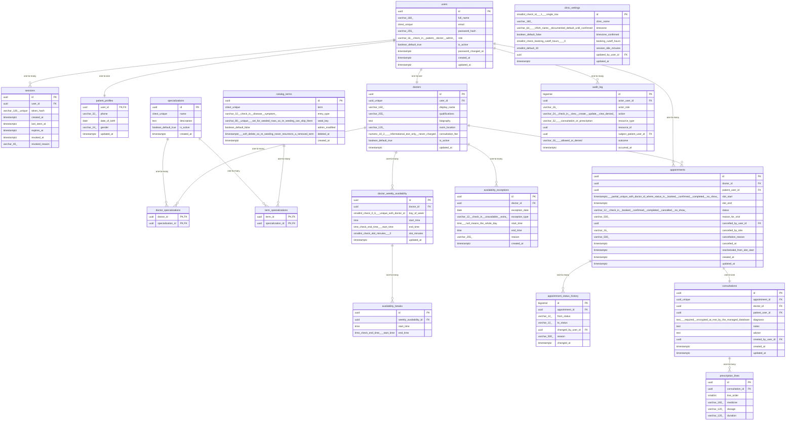

# Data Model

<!-- sdlc:auto:start entities -->
### users

| Field | Type | PK | FK | Nullable |
|---|---|---|---|---|
| id | uuid | True | — | False |
| full_name | varchar(160) | False | — | False |
| email | citext unique | False | — | False |
| password_hash | varchar(255) | False | — | False |
| role | varchar(16) check in (patient, doctor, admin) | False | — | False |
| is_active | boolean default true | False | — | False |
| password_changed_at | timestamptz | False | — | True |
| created_at | timestamptz | False | — | False |
| updated_at | timestamptz | False | — | False |

### sessions

| Field | Type | PK | FK | Nullable |
|---|---|---|---|---|
| id | uuid | True | — | False |
| user_id | uuid | False | users.id | False |
| token_hash | varchar(128) unique | False | — | False |
| created_at | timestamptz | False | — | False |
| last_seen_at | timestamptz | False | — | False |
| expires_at | timestamptz | False | — | False |
| revoked_at | timestamptz | False | — | True |
| revoked_reason | varchar(40) | False | — | True |

### patient_profiles

| Field | Type | PK | FK | Nullable |
|---|---|---|---|---|
| user_id | uuid | True | users.id | False |
| phone | varchar(32) | False | — | False |
| date_of_birth | date | False | — | True |
| gender | varchar(24) | False | — | True |
| updated_at | timestamptz | False | — | False |

### specializations

| Field | Type | PK | FK | Nullable |
|---|---|---|---|---|
| id | uuid | True | — | False |
| name | citext unique | False | — | False |
| description | text | False | — | True |
| is_active | boolean default true | False | — | False |
| created_at | timestamptz | False | — | False |

### doctors

| Field | Type | PK | FK | Nullable |
|---|---|---|---|---|
| id | uuid | True | — | False |
| user_id | uuid unique | False | users.id | False |
| display_name | varchar(160) | False | — | False |
| qualifications | varchar(255) | False | — | True |
| biography | text | False | — | True |
| room_location | varchar(120) | False | — | True |
| consultation_fee | numeric(10,2) - informational text only, never charged | False | — | True |
| is_active | boolean default true | False | — | False |
| updated_at | timestamptz | False | — | False |

### doctor_specializations

| Field | Type | PK | FK | Nullable |
|---|---|---|---|---|
| doctor_id | uuid | True | doctors.id | False |
| specialization_id | uuid | True | specializations.id | False |

### catalog_terms

| Field | Type | PK | FK | Nullable |
|---|---|---|---|---|
| id | uuid | True | — | False |
| term | citext unique | False | — | False |
| entry_type | varchar(10) check in (disease, symptom) | False | — | False |
| seed_key | varchar(80) unique - set for seeded rows so re-seeding can skip them | False | — | True |
| admin_modified | boolean default false | False | — | False |
| deleted_at | timestamptz - soft delete so re-seeding never resurrects a removed term | False | — | True |
| created_at | timestamptz | False | — | False |

### term_specializations

| Field | Type | PK | FK | Nullable |
|---|---|---|---|---|
| term_id | uuid | True | catalog_terms.id | False |
| specialization_id | uuid | True | specializations.id | False |

### doctor_weekly_availability

| Field | Type | PK | FK | Nullable |
|---|---|---|---|---|
| id | uuid | True | — | False |
| doctor_id | uuid | False | doctors.id | False |
| day_of_week | smallint check 0-6 - unique with doctor_id | False | — | False |
| start_time | time | False | — | False |
| end_time | time check end_time > start_time | False | — | False |
| slot_minutes | smallint check slot_minutes > 0 | False | — | False |
| updated_at | timestamptz | False | — | False |

### availability_breaks

| Field | Type | PK | FK | Nullable |
|---|---|---|---|---|
| id | uuid | True | — | False |
| weekly_availability_id | uuid | False | doctor_weekly_availability.id | False |
| start_time | time | False | — | False |
| end_time | time check end_time > start_time | False | — | False |

### availability_exceptions

| Field | Type | PK | FK | Nullable |
|---|---|---|---|---|
| id | uuid | True | — | False |
| doctor_id | uuid | False | doctors.id | False |
| exception_date | date | False | — | False |
| exception_type | varchar(12) check in (unavailable, extra) | False | — | False |
| start_time | time - null means the whole day | False | — | True |
| end_time | time | False | — | True |
| reason | varchar(255) | False | — | True |
| created_at | timestamptz | False | — | False |

### appointments

| Field | Type | PK | FK | Nullable |
|---|---|---|---|---|
| id | uuid | True | — | False |
| doctor_id | uuid | False | doctors.id | False |
| patient_user_id | uuid | False | users.id | False |
| slot_start | timestamptz - partial unique with doctor_id where status in (booked, confirmed, completed, no_show) | False | — | False |
| slot_end | timestamptz | False | — | False |
| status | varchar(12) check in (booked, confirmed, completed, cancelled, no_show) | False | — | False |
| reason_for_visit | varchar(500) | False | — | True |
| cancelled_by_user_id | uuid | False | users.id | True |
| cancelled_by_role | varchar(16) | False | — | True |
| cancellation_reason | varchar(500) | False | — | True |
| cancelled_at | timestamptz | False | — | True |
| rescheduled_from_slot_start | timestamptz | False | — | True |
| created_at | timestamptz | False | — | False |
| updated_at | timestamptz | False | — | False |

### appointment_status_history

| Field | Type | PK | FK | Nullable |
|---|---|---|---|---|
| id | bigserial | True | — | False |
| appointment_id | uuid | False | appointments.id | False |
| from_status | varchar(12) | False | — | True |
| to_status | varchar(12) | False | — | False |
| changed_by_user_id | uuid | False | users.id | False |
| reason | varchar(500) | False | — | True |
| changed_at | timestamptz | False | — | False |

### consultations

| Field | Type | PK | FK | Nullable |
|---|---|---|---|---|
| id | uuid | True | — | False |
| appointment_id | uuid unique | False | appointments.id | False |
| doctor_id | uuid | False | doctors.id | False |
| patient_user_id | uuid | False | users.id | False |
| diagnosis | text - required, encrypted at rest by the managed database | False | — | False |
| notes | text | False | — | True |
| advice | text | False | — | True |
| created_by_user_id | uuid | False | users.id | False |
| created_at | timestamptz | False | — | False |
| updated_at | timestamptz | False | — | False |

### prescription_lines

| Field | Type | PK | FK | Nullable |
|---|---|---|---|---|
| id | uuid | True | — | False |
| consultation_id | uuid | False | consultations.id | False |
| line_order | smallint | False | — | False |
| medicine | varchar(160) | False | — | False |
| dosage | varchar(120) | False | — | False |
| duration | varchar(120) | False | — | False |

### audit_log

| Field | Type | PK | FK | Nullable |
|---|---|---|---|---|
| id | bigserial | True | — | False |
| actor_user_id | uuid | False | users.id | True |
| actor_role | varchar(16) | False | — | True |
| action | varchar(24) check in (view, create, update, view_denied) | False | — | False |
| resource_type | varchar(32) - consultation or prescription | False | — | False |
| resource_id | uuid | False | — | True |
| subject_patient_user_id | uuid | False | users.id | True |
| outcome | varchar(16) - allowed or denied | False | — | False |
| occurred_at | timestamptz | False | — | False |

### clinic_settings

| Field | Type | PK | FK | Nullable |
|---|---|---|---|---|
| id | smallint check id = 1 - single row | True | — | False |
| clinic_name | varchar(160) | False | — | False |
| timezone | varchar(64) - IANA name, documented default until confirmed | False | — | False |
| timezone_confirmed | boolean default false | False | — | False |
| booking_cutoff_hours | smallint check booking_cutoff_hours >= 0 | False | — | False |
| session_idle_minutes | smallint default 30 | False | — | False |
| updated_by_user_id | uuid | False | users.id | True |
| updated_at | timestamptz | False | — | False |
<!-- sdlc:auto:end entities -->

<!-- sdlc:auto:start relationships -->
| Source | Target | Type |
|---|---|---|
| users | sessions | one-to-many |
| users | patient_profiles | one-to-one |
| users | doctors | one-to-one |
| doctors | doctor_specializations | one-to-many |
| specializations | doctor_specializations | one-to-many |
| catalog_terms | term_specializations | one-to-many |
| specializations | term_specializations | one-to-many |
| doctors | doctor_weekly_availability | one-to-many |
| doctor_weekly_availability | availability_breaks | one-to-many |
| doctors | availability_exceptions | one-to-many |
| doctors | appointments | one-to-many |
| users | appointments | one-to-many |
| appointments | appointment_status_history | one-to-many |
| appointments | consultations | one-to-one |
| consultations | prescription_lines | one-to-many |
| users | audit_log | one-to-many |
<!-- sdlc:auto:end relationships -->

<!-- sdlc:auto:start er-diagram -->

<!-- sdlc:auto:end er-diagram -->
