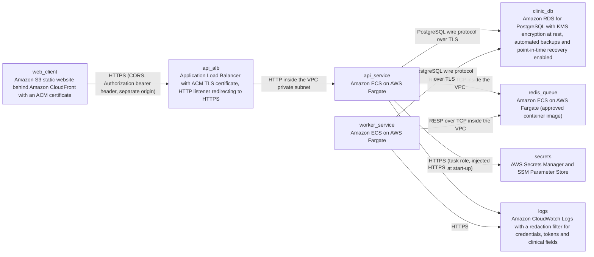

# Deployment Guide

> Maintained by QuorQ AI SDLC. Text between `sdlc:auto` markers is regenerated; anything outside them is yours and is kept.

<!-- sdlc:auto:start how-it-deploys -->
Pushes to `main` run `.github/workflows/deploy.yml`, which builds the API image (if there is a backend) and deploys the SPA to AWS Amplify. Commits touching only `docs/sdlc/**` don't deploy. Deployments can also be started from the platform's Deployment tab.
<!-- sdlc:auto:end how-it-deploys -->

<!-- sdlc:auto:start environments -->
| Name | Service | Runtime | Scaling | Environment |
|---|---|---|---|---|
| web_client | Amazon S3 static website behind Amazon CloudFront with an ACM certificate | React 19 production build (static assets) | CDN-served, no instance scaling | dev |
| api_alb | Application Load Balancer with ACM TLS certificate, HTTP listener redirecting to HTTPS | AWS managed | managed, single dev listener | dev |
| api_service | Amazon ECS on AWS Fargate | FastAPI 0.115 on Python 3.12 (uvicorn container) | 1 task in dev, horizontally scalable to 2-3 tasks | dev |
| worker_service | Amazon ECS on AWS Fargate | Python 3.12 arq worker on the same FastAPI 0.115 image | 1 task in dev | dev |
| redis_queue | Amazon ECS on AWS Fargate (approved container image) | redis:7-alpine | 1 task in dev, private subnet only | dev |
| clinic_db | Amazon RDS for PostgreSQL with KMS encryption at rest, automated backups and point-in-time recovery enabled | PostgreSQL 16 | single-AZ db.t4g.small in dev, Multi-AZ path available later | dev |
| secrets | AWS Secrets Manager and SSM Parameter Store | AWS managed | n/a | dev |
| logs | Amazon CloudWatch Logs with a redaction filter for credentials, tokens and clinical fields | AWS managed | n/a | dev |
<!-- sdlc:auto:end environments -->

<!-- sdlc:auto:start live -->
**Frontend URL:** https://p050247095334.d13el1ykvx8z63.amplifyapp.com

**Backend URL:** https://34-203-70-192.sslip.io/apps/050247095334/

**Database:** PostgreSQL · app

**Version:** e2fdb4bbb9af

**Commit:** `e2fdb4b`

**Finished:** 2026-11-13
<!-- sdlc:auto:end live -->

<!-- sdlc:auto:start topology -->

<!-- sdlc:auto:end topology -->
